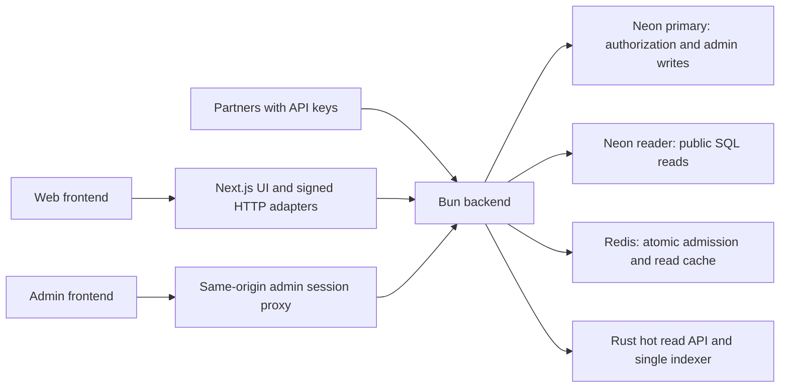

# Bun backend API

Bun 1.4.2 serves public partner reads, private account operations and admin
operations in one deployable application. Shared business logic lives in
`packages/server`; it imports `packages/core` and has no Next.js, React or web
application dependency. Rust retains ingestion and the existing hot memory reads.
Workers and the gas pool stay in TypeScript. A develop-only Render service is
provisioned; final merged-release verification and production rollout remain open.



Next.js retains browser-facing route URLs as thin signed HTTP adapters. The Bun
backend owns the migrated account/session business handlers, including
`/api/social/me` and account creation; it uses the existing session credentials
and primary account records. Coin-page SSR uses one signed, bounded backend read
with a closed lossless bigint/byte-array format. Gateway signatures authenticate
the forwarding context; each owner still verifies user credentials and policy.
No account or session is recreated or rotated. Browser admin calls use the admin
website's authenticated same-origin gateway; its operator bearer stays server-only.

Account, financial workflow, card/share, API gate and maintenance business owners
now live in the backend. Thin Next routes retain their public URLs, signed
forwarding and cookie/page orchestration. Final import cleanup, combined runtime
verification and cold production packaging remain release gates; individual
passing suites do not establish completion of the whole architecture. The shared
admin password without named operators/MFA remains an accepted security gap.

Connected activity SSE streams have a separate bounded lane, so established
streams do not retain ordinary or expensive-work permits. Body, replay and owner
admission finish under the ordinary limit before an accepted GET SSE response
transfers its permit. Stream ownership still counts toward shutdown and remains
held until cancellation and actual owner work complete. Drain aborts established
authenticated stream lifetimes, spread over `streamDrainMs` (30 s for the API
process, 5 s for hints) so browsers reconnect gradually, and cancels a response
that finishes admission after draining begins; unrelated actual work still
completes before shutdown.
Readiness has a separate
bounded, coalesced dependency probe lane and retains dependency/draining failures.

Private contracts name their owner resource independently of wall-clock budgets.
Uploads and image renders retain two permits per class. Trading has its own
lanes inside the aggregate cap (at most eight by default): quotes keep four
permits, two running on the executor's warm workers (reserved) and two waiting
up to a second for one, and trade submissions keep their four permits, two
reserved. Other expensive work is admitted only while
trading's unused reserved permits stay free (four of eight). Small replicas
reserve less, one permit per lane in turn, keeping two for other work. The
remaining provider-heavy and conservatively bounded bulk workflows share four
permits; allowlist imports retain their one-permit bulk sublimit. Wallet fanout
stays in the provider lane. The audited profile-edit GET/HEAD performs a DB projection
read and uses ordinary admission despite its 60-second budget. Other long
workflows remain bounded until their owner costs are assessed; receipt rendering
retains its existing four-workflow limit rather than changing its contention.

`BLAST_BACKEND_MAX_HINT_STREAMS` is optional: default 200, integer range 1–512 per
replica. The maximum derives from a 32 MiB application relay queue payload budget:
512 clients × 64 queued chunks × at most 1 KiB per encoded chunk. Slow readers
close before exceeding 64 chunks; every outgoing frame has the byte bound. This
budget excludes JavaScript/runtime overhead, Bun/kernel socket and proxy buffers,
and bandwidth. One upstream is shared per process. Configuring 512 permits 10,000
simultaneous tabs across at least 20 replicas arithmetically; local connection
checks do not establish production memory, egress, or 10,000-user latency.

## Source organization

`src/main.ts` starts the API. `src/hints-main.ts` starts the separately authorized
hints process. Each entry point delegates to its process startup module.

| Module | Owns |
| --- | --- |
| `app/api/` | API startup, caller admission and Effect HttpApi composition |
| `app/hints/` | Hints startup, stream HttpApi composition and readiness |
| `app/config/` | Shared transport and fleet configuration |
| `app/server.ts`, `app/health-http.ts` | Shared HTTP composition and the Effect health probes |
| `data/api/`, `features/` | Effect HTTP contracts and feature handlers |
| `transport/server.ts`, `transport/http.ts` | Bun sockets, request admission and transport response headers |
| `transport/request.ts` | Target validation, ingress identity and gateway authentication |
| `transport/admission.ts` | Process capacity, connected-stream permits and drain |
| `transport/private-admission.ts` | Expensive private work and reserved trading capacity |
| `transport/lifetime.ts` | Deadlines, cancellation and permits through body settlement |
| `transport/health.ts` | Coalesced readiness probes in a separate admission lane |
| `transport/private.ts`, `transport/cron.ts` | Authenticated capability adapters to shared server owners |

ESLint keeps API and hints wiring separate. Shared app modules can be used by
either process. The app supplies handlers to transport, and transport stays
independent of process wiring and feature handlers. Bun access lives in transport.

Business workflows, provider integrations and named persistence operations remain
in `@blast/server`; shared route and security contracts remain in `@blast/core`.
Add behavior to its existing owner and keep these adapters focused on transport.
A permit is released only after response and registered work settle, including
work that ignores cancellation. Partner scheduling metadata never grants access:
each admitted key still receives fresh primary authorization.

Run `npm run format -w @blast/backend-api` to fix lint and formatting, or
`npm run format:check -w @blast/backend-api` to check both without writes.
The backend architecture CI gate runs the same style check.

### Framework boundary

Bun owns sockets, peer addresses and native body/idle limits. It passes raw Fetch
requests and peer context to the transport. The transport verifies gateway
signatures, enforces body limits and fills missing `nosniff` and request-ID
headers. Effect HttpApi dispatches admitted routes to their owners. Define new
contracts with Effect Schema. Preserve exact signed bytes and the authenticated
context when an owner must validate them before parsing. Hints scope each
subscriber to its response stream. Reuse the shared owners for Privy JWT
verification, canonical ingress addresses and structured logging.

Backend startup and after-response failures use the shared Pino JSON format.
`backend.listening` goes to stdout with the process role. `backend.after_response_failed`
goes to stderr. Use stable event names and safe scalar fields such as role labels
or counts. Keep raw errors, request data, and credentials out of logs. Effect
HTTP access logging stays disabled so each request retains its existing transport
observations.

API admission owns shared quotas and the signed gateway proofs spent by those
decisions. Transport owns request authentication, reserved trading capacity,
and permit release after actual work settles. Response completion alone cannot
release work that ignores cancellation.

## Configuration and authority

Use `.env.example` for public URLs and secret placeholders. Keep private env files
ignored. Preserve existing database URLs, regions, deployment identity, network,
Privy app/verification key, wallet-session credentials, rate-limit subject pepper,
Redis namespace and counter identities.

### Hosted configuration

The web app selects its API with server-only `BLAST_BACKEND_API_ORIGIN`.
Browser streams use the separate hints process. See the
[hosting guide](../../docs/deploy/RENDER.md) for the two process entry points,
gateway settings and Render's shutdown allowance.

The primary verifies partner keys on every admitted use; public reads never
verify or touch user sessions. Ordinary public SQL reads use the
existing reader. There is no authorization cache or fallback to a different
primary. Production startup requires `BLAST_DEPLOYMENT_TARGET`, a
`BLAST_DEPLOYMENT_BRANCH` outside production, and a matching
`BLAST_BACKEND_EXPECTED_QUOTA_NAMESPACE`. The latter is the existing derived
`quotaNamespace`, rather than a newly chosen value.

The web server requires `BLAST_BACKEND_API_ORIGIN` for partner admission and
explicit first-party public-read adapters. Local workflows run the same Bun
backend at a loopback origin. Missing or invalid configuration returns a bounded
503; there is no local admission or public-handler fallback. The gateway performs no second key lookup or quota charge. Its separate
`BLAST_BACKEND_GATEWAY_SECRET` signs the exact method, target, original
credential digest, client address, quota namespace and timestamp. Public frontend
reads reject partner headers and strip cookies/Authorization before signing. Redis
atomically claims the nonce with the first admission; a refusal burns that nonce
without spending quota. Proofs grant no admin or user identity. Canonical private
owners independently verify the existing account/session credentials forwarded by
Next; a valid gateway signature does not replace that authentication.

Partner calls use fresh primary key/policy checks and existing atomic Redis
budgets, including on cache hits. First-party public reads are anonymous, skip
commercial partner budgets and retain IP/endpoint abuse limits. Their public data
is accessible anonymously and can be scraped within those limits; browser traffic
cannot be reliably attributed to a partner. Internal-tier partner
keys grant no operator authority.

Admin operations exist only in the backend, one row each in `OPERATOR_ROUTES`
(`packages/core/src/modules/backend-api/operator-routes.ts`). The admin website
authenticates its existing cookie, checks same-origin writes and injects the
existing `PRESALE_ADMIN_TOKEN`. The transport checks that bearer once, before
admission, for every row whose `auth` is `operator`; unknown `/api/admin` paths
are 404 before auth. Set the admin server's `BLAST_BACKEND_API_ORIGIN` before using this
backend architecture. There are no legacy Next admin aliases. Shared password
access, absent MFA and non-individual audit attribution remain open security gaps.

### Profile photo uploads

The backend owns `/api/social/me/profile/picture`. Set the server-only
`LAUNCH_ASSET_BLOB_READ_WRITE_TOKEN` on the backend to a token for the existing
**public** Blob store used by launch images and profile photos. Restart the
backend after changing it: the profile handler resolves its store once per
process. Setting it only on the Next frontend does not configure this owner.

Leave it empty when storage is unavailable. The profile read then returns
`upload_available: false`, and the upload endpoint refuses with
`picture_upload_unavailable`; name editing still works. A failed storage write
also refuses without replacing the current photo. `BLOB_READ_WRITE_TOKEN` is
separate private card storage and must not be reused as a fallback. Never put
these tokens in browser configuration, committed env files or logs.

An operator must verify the existing public store and configure its token in
the backend environment before hosted uploads can work. Local adapter tests
prove normalization, authorization, persistence and refusal behavior; they do
not provision storage or establish hosted upload success.

## Resource and deployment limits

The transport passes raw requests to their owners. The application bounds parsed
headers and targets to 16 KiB, admin bodies to 8 KiB, total in-flight work to 64 by default,
and admin work to 4 within that total. Public and operator operations have a
four-second deadline. Ordinary private operations use 30 seconds; reviewed route
contracts explicitly select longer budgets where needed, up to 300 seconds.
Maintenance cron operations use 60 seconds. These deadlines cover body reading,
owned work and response streaming. Timed-out work that ignores cancellation
retains its permit until it settles. Separate bounded image/SDK workers release
their slots only after actual termination, and background work has no unbounded
queue.

Bun's ordinary socket idle timeout is five seconds. Recognized browser private
routes get an initial 40-second allowance; an authenticated selected private route
then uses its finite work budget plus ten seconds. For budgets beyond Bun's
255-second idle-timeout limit, only that authenticated request disables socket
idleness while the finite HTTP deadline still applies. Shutdown joins admitted
and background work. Its outer deadline is the maximum private/maintenance work
budget plus ten seconds, normally 310 seconds. Off Render, production keeps those defaults.

Any identity may set `BLAST_BACKEND_MAX_PRIVATE_WORK_MS=280000`. This caps actual private HTTP work
and its authenticated socket allowance, then derives a 290-second application
shutdown deadline, leaving ten seconds within a 300-second host allowance.
The optional cap accepts integer milliseconds from 180000 through 280000. On Render
(`RENDER` set), the API refuses to start without it: Render kills an instance
at most 300 seconds after SIGTERM, and the uncapped 310-second drain cannot fit
(#491). Existing contracts of 180 seconds or less, including the 90-second
financial operation deadline, remain unchanged. Omitting the setting elsewhere
preserves the original route budgets. This configuration alone does not verify
the host's shutdown behavior; the host must supply the matching allowance
(`blast-backend-api` sets Render's maximum, 300 seconds). Work ignoring cancellation retains admission until it settles
or the application's outer shutdown deadline terminates the process.

Bun exposes no documented equivalent of an absolute pre-header assembly deadline
or Node's socket cap. These application tests do not close that ingress gap.
Before deployment, require a verified reverse proxy with header/connection/rate
limits and slow-client protection. Choose `BLAST_BACKEND_INGRESS_MODE=direct`
for socket-address identity with forwarding headers ignored. In `trusted-proxy`
mode, configure `BLAST_BACKEND_TRUSTED_PROXY_CIDRS` (at most 32 explicit IPv4 /24+
or IPv6 /64+ ranges, or exact IPs). Only those peers may supply exactly one
`X-Forwarded-For` address; unknown peers and absent/ambiguous addresses fail closed.
IPv4-mapped IPv6 normalizes consistently. Private ranges are never auto-trusted.
Render's actual proxy ownership and overwrite behavior remain an unverified
hosted release prerequisite; do not invent ranges for it.

`/v1/live` reports process liveness. `/v1/health` bounds and coalesces Redis and
primary checks. Health is not proof of product readiness. Choose replica counts
within the aggregate primary/reader connection budget and provision a dedicated
least-privilege database role before rollout. The API accepts only
`CREATOR_CLAIM_SIGNER_KEY` for offchain creator-account attestations. Register its
32-byte Ed25519 public key in the launchpad RuntimeConfig before enabling account
claims. Transaction signer keys remain worker-only; the hints service rejects all
signer keys.

## Local verification

Use the integration harness to start disposable PostgreSQL and Valkey on
loopback. No chain transactions are needed.

```sh
npm run typecheck --workspace @blast/server
npm test --workspace @blast/server
npm run typecheck --workspace @blast/backend-api
npm test --workspace @blast/backend-api
npm run test:integration --workspace @blast/backend-api
```

The physical suite launches two actual Bun backend processes and a frontend
relay. It verifies fresh policies and revocations, exact shared quotas,
no double charging, anonymous public relays, operator commands and isolation,
and SQL-backed admin reads. Separate private identity integration verifies
genuine Privy and wallet sessions and existing non-null account preservation.
The Rust/gas-pool HTTP sources are loopback fixtures, so these tests establish no
hosted capacity or Rust correctness.

The mixed-load suite seeds 10,005 keys and covers cold/warm reads and anonymous
public traffic, including requests presenting credentials that the relay strips. It includes a 12 ms database/Redis RTT
profile, mid-run revocation, Redis recovery and process restart. Set
`BLAST_BACKEND_LOAD_DURATION_MS` for a longer sustained run; synthetic capacity
limits are distinct from production quota defaults. Optional
`BLAST_BACKEND_TEST_CGROUP=512` runs each Bun backend under a real 512 MiB cgroup
with sources/dependencies mounted read-only. RSS includes native allocation;
Node/V8 heap flags do not constrain Bun.

Build the production image with BuildKit and run `scripts/backend-image-contract.mjs`
without network or secrets. Its strict context excludes frontend runtime source, private environment files,
dependency trees and test artifacts. It admits only the explicitly hashed public
card-rendering asset allowlist; those files remain sourced in `apps/web/public`.
The packaged backend verifies their hashes and rejects extra assets. CI retains type,
contract, physical admission and production image gates. See `verification.md`
for earlier source-bound evidence; Node results there describe the earlier runtime
and are not Bun measurements.

Partner recognition requires migration `0131_partner_recognition_marker` and an
explicit `BLAST_PARTNER_CAPACITY_CONFIG` JSON document. There is no production
capacity default. Its tenant reservations must cover every active key's full
minute entitlement; their sum plus anonymous, unknown, preflight, admin and internal
reserves must fit the declared measured envelope. An absent configuration,
capacity deficit, missing role grant or incomplete registry fails closed.
Configure and enforce `maxReplicas` in the deployment before release; local
concurrency is conservatively divided by that maximum, without borrowing.

The primary recognition generation/revision marker is a database singleton.
All live backend replicas sharing that database must use the same capacity
fingerprint and recognition-store configuration. Different capacity documents
cannot operate independently merely by choosing different Redis namespaces:
competing reconciliation can invalidate recognition and refuse issuance. The
2026-10-26 cross-task collision was resolved by suspending the duplicate service;
this task retains the service above. Keep one coordinated configuration/store
across live replicas, or a separate database for an independent deployment.

For a reviewed preview with its own branch identity, set
`BLAST_PARTNER_RECOGNITION_NAMESPACE` to the existing registry's 64-character
lowercase hex recognition namespace. It defaults to `quotaNamespace` so existing
deployments retain their store. Every coordinator must still use the same quota
Redis, subject pepper and exact capacity document, and the total replica count
must stay within that document's `maxReplicas`. This setting changes only the
recognition store; gateway proofs, request quota counters and replay protection
retain the candidate's actual environment/branch namespace. Configure a dedicated
backend's expected quota namespace and site origin for that candidate; do not
replace its Vercel branch identity or reuse production counters. Limit frontend
credentials to the reviewed branch, protect private previews at the hosting
layer, and remove temporary preview credentials and services after the PR closes.

The configured operational `partner_read_global` ceiling replaces the old
600/minute ceiling **only in its cap**. Bucket name, version, global subject,
60-second window and Redis key are unchanged: existing usage is retained.
Per-key paid minute/day limits, key UUIDs, endpoint charging and internal
commercial exemption remain unchanged. The local fixture capacity document is
synthetic and is not a production sizing recommendation.

Redis recognition stores only an HMAC of the existing key hash and immutable
scheduling identities plus a configuration-bound operational key ceiling. No tier, validity or grant is cached. Every admitted known key is authorized freshly against
the primary. Complete-map unknown keys receive401 after their bounded abuse
admission, without SQL; an unready/corrupt map or uncertain connection gets503.
Preflight origins are scheduling metadata only and may remain permissive until
reconciliation; actual key/origin authorization is always fresh. All supported
issuers/importers and recognition-affecting admin writes must use the common
primary advisory-lock/precommit-publication owner. Out-of-band key imports are
unsupported until controlled reconciliation.

Before SQL, recognized traffic uses a per-key operational rate bound and a
bounded scheduler: round-robin tenant, then nonempty key queues, sharing two
fresh authorization workers. Aggregate queue and concurrency limits do not grow
with key count. A paid or revoked key cannot exhaust another key's pre-SQL
tenant/IP budget. After fresh authorization, paid calls use a paid response lane first. Commercial minute/day, endpoint and tenant operational
counters are then admitted in one Redis transaction, after method/path/Origin
checks; a refusal spends none of these allowances. There is no tenant-IP
operational counter; internal calls use a separate bounded
physical rate counter and response lane. Mixed internal/paid tenants remain
supported. Commercial counters are unchanged. Internal authorization still
shares the two fair SQL workers; this supplies no independent SQL capacity or
guaranteed latency under a fleet-wide attack. `internalMaxInflight` and the
internal reserve are explicit deployment capacity, not commercial entitlement.

Administrative publication uses a bounded union of committed-before and
candidate-after identities/origins before COMMIT. Rollback can leave bounded
false positives, which never grant access. Primary generation/revision and the
Redis connection epoch detect stale restored metadata during controlled
startup/reconnect reconciliation. A process-owned singleflight recovery loop runs
every 1–5 seconds, independently of health polling, and is joined at shutdown.
Local Redis queue saturation refuses only that request; socket/epoch/protocol
uncertainty invalidates negative-membership authentication until handshake. A
valid conservative map remains readable during bounded snapshot preparation;
replacement validates its captured marker atomically. Precommit unions carry
a durable needs-trim bit, and a separately locked CURRENT primary snapshot
prunes them after commit. Recognized-origin preflights use a separate configured
reserve within the same total envelope and never grant data access or spend
unknown-key/commercial quotas. A selective Redis rewrite that preserves all
connections is outside that attested storage contract. Hosted noeviction,
durability, recovery and maximum-replica enforcement still need verification.
The current verifier and administrator use the existing shared primary role;
the new marker grants no PUBLIC access, but deployed verifier credential/role
separation remains an explicit security gap.

The canonical backend owns `/api/gate` refresh. Next keeps proxy/page cookie
orchestration and a thin signed transport. Set the same server-only
`BLAST_GATE_SECRET` of at least 32 characters on Next and Bun, including local
multi-process development. Refresh cookies use that shared key across processes.
Missing shared refresh configuration fails closed before database access. Preserve
the existing current and previous API gate keys.

`ADMIN_LOGIN_ADMISSION_TOKEN` authenticates only the exact login-attempt admission
endpoint. It must be at least 32 characters and distinct from the valid operator
`PRESALE_ADMIN_TOKEN`; absent, short or equal configuration fails 503 before body
parsing or quota work. Operator routes reject this narrow credential. Admin
middleware uses only the dedicated token and never falls back to the operator
token. Existing account/session/key/counter identities are unchanged; provision the
separate secret before release, without rotating existing operator or session
keys.

### Dedicated partner verification login

`PARTNER_VERIFIER_DATABASE_URL` is required. It names the same primary pooled
endpoint and database as `DATABASE_URL`, using a distinct login inheriting only
`blast_partner_verifier` (migration0132). That privilege role has schema USAGE
and SELECT only on the exact columns used for fresh key/origin checks. No key,
policy, recognition generation/revision or commercial counter changes occur.
Canonical readiness probes this real verifier pool, and shutdown closes it.

Verification retains two connections and existing deadlines. Recognition/admin
writes retain their existing primary control pool. Partner quotas live only in
Redis; a configured Redis failure never falls back or resets allowances.

Deploying requires separately provisioning a login, setting this server-only URL
and verifying its real membership/grants. Example files contain placeholders.
A distinct URL alone does not prove least privilege. The same Bun process
intentionally retains control credentials; this is connection authority separation,
not process isolation.
