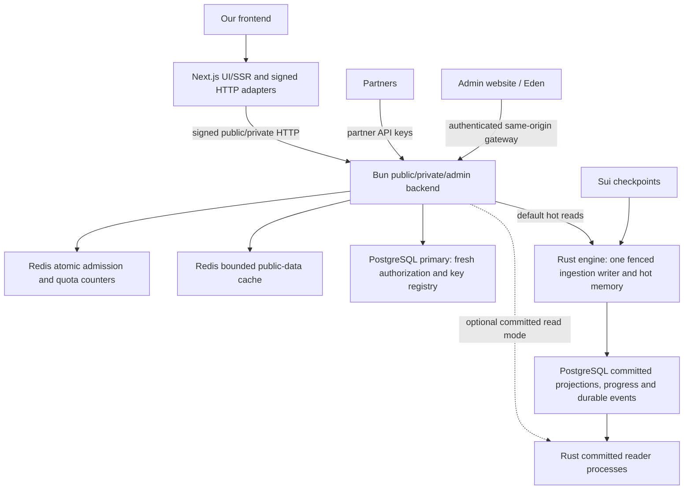

# Independent read serving and unified admission

Status: current local architecture decision, 2026-10-25. This document supersedes
the earlier partial-reader proposal. Nothing here authorizes a hosted deployment.

## Responsibility boundaries

The Bun backend owns partner admission, configured caller policies, Redis
quotas and public-data caching. Partner traffic can reach it directly. Selected
public frontend routes are signed adapters to that backend; missing or invalid
backend configuration returns explicit unavailability. They do not construct a
second admission stack or silently serve through an older local implementation.
Local workflows run the backend and configure its loopback origin as well.

Next.js keeps the browser-facing account/session URLs as thin signed HTTP
adapters; canonical Bun handlers own migrated account/session reads and mutations.
The coin SSR page reads its data and context in one signed backend request with
bounded, lossless bigint and byte-array encoding. The inventoried financial, share/background and cron families now also dispatch
to shared backend owners; the current inventory and transport contracts live in
`apps/backend-api/README.md`. Their local checks do not complete the remaining
replay, load and release acceptance gates in infra #59. Browser cookies
and bearer credentials keep their existing verification semantics. Gateway
signatures authenticate the forwarding context; they do not turn arbitrary
headers into a first-party identity. First-party commercial exemptions remain
separate from bounded anonymous/IP admission. Partner authorization and revocation
use current primary state before quota admission and cache access. No migration
resets accounts, sessions, key IDs, hashes, policies or quota counters.

The public API and admin control routes share one backend process. Route-level
authentication and authorization remain separate, but this process is a shared
trust domain and is not a read-only public database principal. Replacing the
shared admin password with named MFA identities remains an accepted security gap;
a read-architecture change cannot close it. Workers and gas-pool remain separately
authorized TypeScript processes; API and reader roles need no signer credentials.

## Hot memory and optional committed reads

The Rust engine keeps the single fenced ingestion writer and its hot-memory read
path. Local memory-versus-PostgreSQL experiments did not justify forcing every
hot route through SQL. The writer's finite ingestion and hot-read capacity remains
a real limit; independent SQL readers are an explicit alternative with their own
measured latency, connection and freshness costs.

`BLAST_INFRA_READ_MODE` is empty by default: market reads intentionally reach the
hot-memory writer. To select a separately verified complete reader, set it to
`committed-markets` and set server-only `BLAST_INFRA_READ_ORIGIN` to that reader's
bare origin. Canonical market/presale GET/HEAD reads then select the complete
reader. Unknown routes and mutation methods do not. Server-side WebSocket
connections (`blastInfraSocketUrl`, the hints backend) always need the reader:
the writer serves no `/v1/ws`, so without this mode the hints backend refuses
to start and any other socket open throws. Invalid explicit configuration fails
closed. Reader refusal, transport
failure and redirect never trigger a writer retry or a second quota charge.
The obsolete raw-activity-only routing mode has been removed.

Committed readers consume committed projections with their corresponding progress
and identity. They do not acquire the ingestion writer lock or run migrations.
Snapshot consistency, correction/replay ordering, stale-sensitive refusal and
reader reconnection are correctness requirements, not optional optimizations.
Redis notification loss cannot erase the durable replay source. Cached public
responses retain bounded freshness and size; sessions, financial authorization
and revocation remain authoritative primary decisions.

## Latency and scalability controls

Keep backend, Redis and PostgreSQL near each other. Budget connections across all
replicas while reserving writer/admin/recovery capacity. Bound in-flight work,
queues, response bytes, pagination, stream replay and request deadlines. Atomic
quota operations retain their established counter identities and expiry semantics.
Quota storage requires no eviction; disposable data caches have different eviction
needs. Additional replicas do not remove shared database/Redis saturation ceilings.

The local evidence combines actual Bun processes, disposable PostgreSQL/Valkey,
synthetic identities, realistic delayed store calls, cold/warm reads and ingestion
under read load. Some backend mixed-load runs use Rust/gas-pool fixtures; they
measure backend admission and transport, not the whole physical Rust engine.
Read the exact source-bound report before interpreting any latency percentile as
whole-system capacity. Prior Fable scores describe their original narrow scopes;
they do not grade the complete architecture or hosted production readiness.

## Completion and release gates

The #59 implementation must pass its source-bound Rust release and regression
checks, complete-reader partition/cold/warm/ingestion workloads, current backend
and frontend checks, synthetic preservation controls and an independent architecture
review. Explicitly record failed or unexecuted gates. Hosted roles, connection
ceilings, real proxy header behavior, shutdown allowances and production workloads
remain a later authorized verification phase. All current work is local; no
Render, hosted Neon/Vercel product calls or on-chain transactions are required.

The [backend architecture workflow](../../.github/workflows/backend-architecture.yml)
checks transport contracts, integration behavior with local PostgreSQL and
Valkey, and imports from the built backend image.
